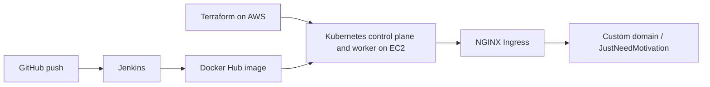

# JustNeedMotivation deployment

## Architecture



Terraform creates the AWS network and EC2 nodes only. Kubernetes, its ingress controller, and application resources must be installed separately.

## Local checks

Run from the repository root:

```sh
docker build -t justneedmotivation:local .
docker compose up --build
```

The compose app reads `.env` and uses its `JWT_SECRET` and optional `GEMINI_API_KEY`. The compose file points `MONGODB_URI` to its MongoDB service unless a local `.env` overrides it. Stop compose with Ctrl+C, then `docker compose down`.

For Terraform, copy `terraform/terraform.tfvars.example` to `terraform/terraform.tfvars`, set `my_ip_cidr` to your actual public IP CIDR, and set `key_name` to an existing EC2 key pair. On PowerShell, copy it with:

```powershell
Copy-Item terraform/terraform.tfvars.example terraform/terraform.tfvars
```

Terraform uses AWS credentials from the standard AWS provider credential chain; none belong in these files.

```sh
cd terraform
terraform init
terraform validate
terraform plan -var-file=terraform.tfvars
cd ..
```

The plan creates billable public EC2 instances and network resources. Do not apply it until you have reviewed the plan and AWS costs.

With a reachable Kubernetes context configured, validate the manifests without creating resources:

```sh
kubectl apply --dry-run=client -f k8s/
```

## Manual Kubernetes setup

1. Review the Terraform plan, then create the infrastructure yourself. SSH is restricted to `my_ip_cidr`; HTTP/HTTPS are public; the configured Kubernetes node ports are limited to the VPC CIDR.
2. Install and configure `containerd`, `kubelet`, `kubeadm`, and `kubectl` on both Ubuntu 22.04 instances using the [official kubeadm installation guide](https://kubernetes.io/docs/setup/production-environment/tools/kubeadm/install-kubeadm/) for the same supported Kubernetes minor version.
3. On the control-plane node, initialize the cluster with its private VPC address and the Flannel pod CIDR:

   ```sh
   sudo kubeadm init --apiserver-advertise-address=<CONTROL_PLANE_PRIVATE_IP> --pod-network-cidr=10.244.0.0/16
   ```

4. Configure `kubectl` for the control-plane user as printed by `kubeadm init`, install a matching [Flannel CNI release](https://github.com/flannel-io/flannel), and run the `kubeadm join` command printed by `kubeadm init` on the worker.
5. Install the [NGINX Ingress Controller](https://kubernetes.github.io/ingress-nginx/) as a DaemonSet with host ports 80 and 443; the security group exposes those ports on the nodes and does not provision a load balancer. Point DNS A records at worker public IPs where the ingress pods are running. Install [Metrics Server](https://github.com/kubernetes-sigs/metrics-server) for HPA metrics. These components are not provisioned by Terraform.
6. Create `k8s/secret.yaml` from `k8s/secret.example.yaml`; replace every placeholder with real values and do not commit the resulting file. Set `MONGODB_URI` to a reachable MongoDB deployment and set `JWT_SECRET`. MongoDB is included in local Compose only; this Terraform/Kubernetes setup does not provision a production database.
7. Set the Docker Hub image in `k8s/deployment.yaml` to your account, then apply the namespace and remaining manifests:

   ```sh
   kubectl apply -f k8s/namespace.yaml
   kubectl apply -f k8s/
   ```

   Configure DNS for `jnm.example.com` to resolve to the ingress endpoint, or replace the placeholder with your domain. Add TLS only after issuing a certificate and configuring cert-manager.
8. Configure Jenkins with Docker Hub username/password credential ID `dockerhub-creds`, a kubeconfig secret-file credential ID `kubeconfig`, Docker and kubectl CLIs, and access to this repository. The Jenkins agent must have network access to the control-plane API, which is restricted to the VPC. Set the `DOCKERHUB_USERNAME` pipeline parameter. The Deploy stage updates an existing `justneedmotivation` Deployment in the `justneedmotivation` namespace.

## Screenshots to capture yourself

- [ ] Successful Jenkins pipeline run
- [ ] Docker Hub image tags
- [ ] Terraform apply output
- [ ] `kubectl get pods`, `kubectl get hpa`, and `kubectl get ingress`
- [ ] The live site in a browser

Add `architecture.png` and your screenshots yourself; none are included in this repository.
